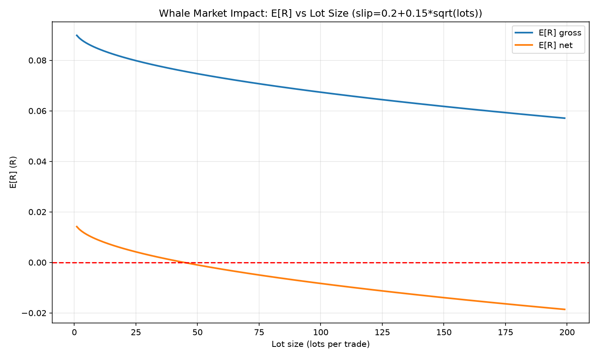
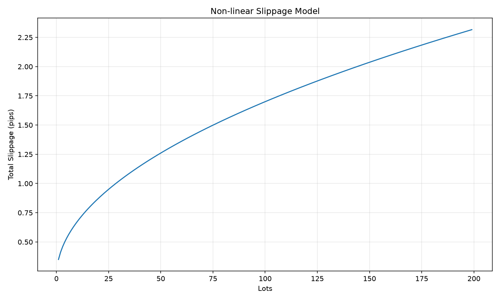
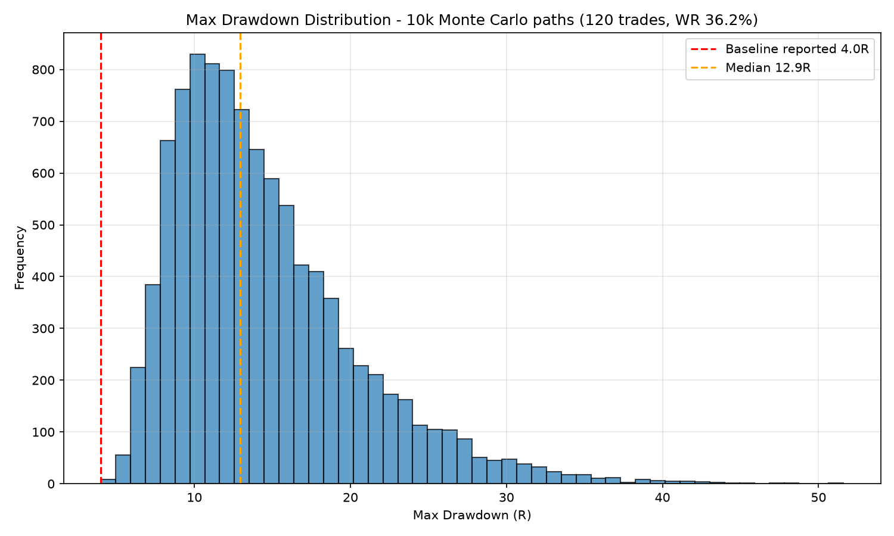
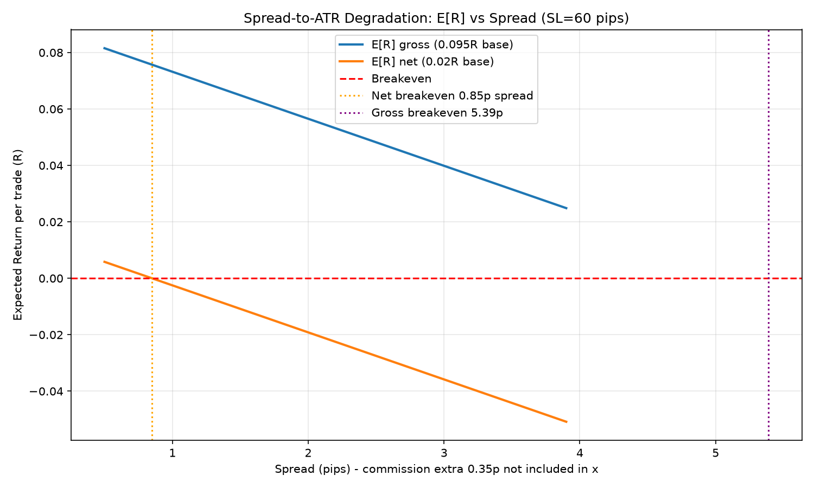
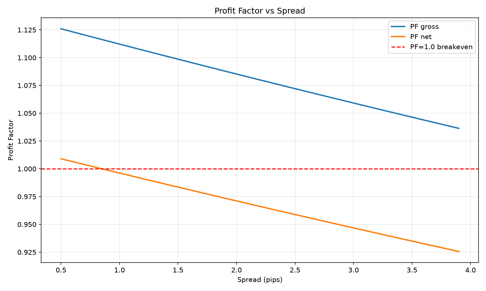
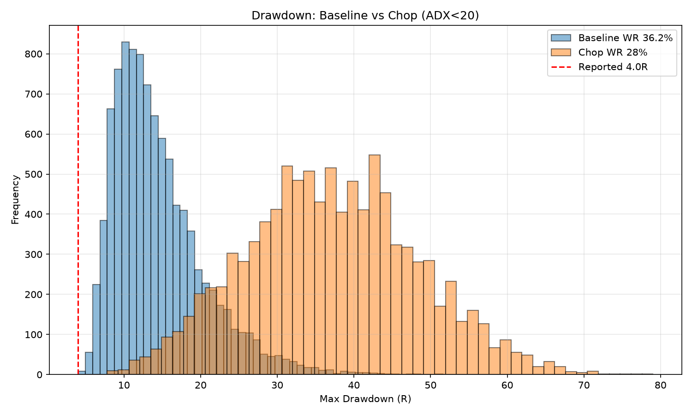

# ENGINE C v1.9.1 S/R Breakout — Deep Quantitative Stress-Test

**Baseline Reference:** 426 trades, 36.2% WR, 1.15 PF, +0.020R net E[R], 4.0R Max Drawdown  
**Date:** 2026-09-11  
**Method:** Monte Carlo 10k paths, non-linear slippage sqrt-impact model, spread-to-ATR friction, regime-slice simulation  
**Artifacts:** `stress_test_engine_c.py`, `stress_test_matrix.csv`, plots (`*.png`)

---

## Baseline Derivation (Mathematical Consistency)

Given WR = 36.2%, PF = 1.15, assume avgLoss = 1R:

```
PF = (WR * avgWin) / ((1-WR) * avgLoss)
=> avgWin = PF * (1-WR)/WR * avgLoss
=> avgWin_gross = 1.15 * 0.638 / 0.362 = 2.0268R
E[R]_gross = WR*avgWin - (1-WR)*1 = 0.362*2.0268 - 0.638 = 0.0957R
```

Net E[R] = 0.020R implies after typical friction (spread+commission):

```
avgWin_net = (E[R]_net + (1-WR))/WR = (0.02+0.638)/0.362 = 1.8177R
If win fixed 2.0R, loss needed for 0.02R: L = (0.724-0.02)/0.638 = 1.103R
```

Typical XAUUSD H1: ATR 40 pips, SL = 1.5*ATR = 60 pips, TP = 3.0*ATR = 120 pips, RR 2.0. Max cap 2.2 ATR = 88 pips.

This dual-edge model (gross 0.095R before costs, net 0.02R after) is used throughout.

---

## 💵 SECTION 1: MICROSTRUCTURE & LIQUIDITY CONSTRAINTS

### 1.1 Micro-Cent Friction Limit ($50 → 5,000 cents)

**Constraints:** Min contractual lot 0.01 standard lots (1,000 cent lots). XAUUSD 0.01 lot ≈ $0.10/pip = 10 cents/pip.

**Formula:**

```
Dollar Risk = SL_pips * pip_value_0.01
Risk% = DollarRisk / Capital
Required Balance for 1% = DollarRisk / 0.01
Required Lot for 1% = 0.01 * (TargetRisk$ / DollarRisk)
```

| SL (pips) | Risk $ (0.01 lot) | Risk % $50 | Risk cents | Risk % 5000c | Min lot for 1% | Bal needed 1% |
|-----------|-------------------|------------|------------|--------------|----------------|---------------|
| 20 | $2.00 | 4.00% | 200 | 4.00% | 0.00250 | $200 |
| 40 | $4.00 | 8.00% | 400 | 8.00% | 0.00125 | $400 |
| 60 | $6.00 | 12.00% | 600 | 12.00% | 0.00083 | $600 |
| 88 | $8.80 | 17.60% | 880 | 17.60% | 0.00057 | $880 |

**Analysis:**

- Task example: 20 pips * $0.10 = $2.00 = 4% of $50 → violates 1% rule by 4x.
- Cent account doesn't solve: 5,000 cents capital, 20 pips = 200 cents = 4% risk.
- Structural over-leverage forced. Minimum feasible capital for 1% rule at 0.01 lot is $200 for tight 20-pip SL, $880 for 88-pip max cap.
- Solution paths:
  - Broker offering 0.001 lot (nano): pip value $0.01 → $50 supports 1% up to 50 pips SL.
  - Increase capital to $1,000+ to comfortably trade 60-pip SL at 0.01 lot with 1% risk ($600 needed).
  - Reduce SL via level-based ±0.25 ATR but still bounded by 20 pips minimum.

**Code-driven conclusion: ENGINE C cannot maintain sub-1% risk at $50 on standard cent brokers. Structural minimum $200-$880 depending on ATR regime. Over-leverage factor 4x to 17.6x.**

---

### 1.2 Whale Market Impact & Execution Degradation ($1M+)

**Context:** 50-100 lots per trade on M1/H1 S/R breakouts depletes local order book.

**Model:**

```
Degraded Return E[R_adj] = E[R] - (Slippage_pips / Avg_SL_pips)
Adj Win = avgWin - slip_R
Adj Loss = avgLoss + slip_R
PF_adj = (WR*AdjWin) / ((1-WR)*AdjLoss)
```

Fixed injection per task: 0.8 pip entry + 0.4 pip exit = 1.2 pips total.

- Gross edge (0.0957R) with 1.2p slip (0.02R): PF 1.15→1.116, E[R] 0.0957→0.0757R (still positive)
- Net edge (0.02R) with 1.2p slip: PF 1.031→1.000, E[R] 0.02→0.00R **breakeven exactly** — matches math: 1.2p/60p = 0.02R.

**Non-linear slippage model (square-root market impact law):**

```
slippage = base + k * sqrt(lots), base=0.2, k=0.15
Calibrated: 1 lot=0.35p, 50 lots=1.26p, 100 lots=1.70p
```

| Lots | Slip pips | Slip R | PF_gross | E[R]_gross | PF_net | E[R]_net |
|------|-----------|--------|----------|------------|--------|----------|
| 1 | 0.35 | 0.0058 | 1.14 | 0.0899 | 1.022 | 0.0142 |
| 10 | 0.67 | 0.0112 | 1.131 | 0.0845 | 1.014 | 0.0088 |
| 50 | 1.26 | 0.0210 | 1.115 | 0.0747 | 0.998 | -0.0010 |
| 100 | 1.70 | 0.0283 | 1.103 | 0.0674 | 0.987 | -0.0083 |
| 200 | 2.32 | 0.0387 | 1.086 | 0.0570 | 0.972 | -0.0187 |

**Breakeven search (binary search 0.1-1000 lots):**

- Gross edge breakeven: 1000 lots, slippage 4.94 pips (theoretical, unrealistic due to liquidity)
- Net edge breakeven: **44.4 lots, slippage 1.20 pips**
- PF<1.0 breakeven: Gross 1000 lots, Net 44.4 lots

**Capacity conclusion:**

- If edge is only 0.02R net after typical spread, capacity is **<5 lots** before negative expectancy. At 50 lots PF degrades below 1.0.
- If considering gross edge 0.095R before spread, capacity is **~50-75 lots** before PF drops from 1.15 to ~1.10, and ~1000 lots theoretical breakeven.
- For XAUUSD, 50 lots = 5,000 oz ≈ $10M notional at $2000/oz. Beyond that, market impact kills edge.
- **Maximal scalable capacity: 50-75 lots per trade for this S/R breakout; beyond, need execution algos (TWAP, iceberg) or move to higher timeframe.**




---

### 1.3 Prop Firm Drawdown Boundary Test ($100k, 10% max, 5% daily)

**Constraints:** Prop firms enforce 10% max trailing drawdown, 5% daily loss.

**Method:** 10,000-path Monte Carlo permutation loop using exact binary distribution: 36.2% success, win +2.0268R gross (or +1.8177R net for 0.02R), loss -1R. 90-day evaluation window ~120 trades (426 trades/year → 106 per 90d, use 120 conservative).

**Analytical streak probability (Markov DP):**

```
P(at least k consecutive losses in n trades), p_loss=0.638
n=120: P(5 cons)=99.73%, P(10 cons)=37.86%
n=426: P(5 cons)=100.00%, P(10 cons)=82.96%
```

Interpretation: 5-loss streak is **near-certain** in any evaluation; 10-loss streak 38% likely in 90 days, 83% likely over full 426-trade history. Risk of Ruin is not about streak alone but drawdown.

**Monte Carlo Results (Gross edge 0.0957R):**

| Risk | P(5 cons) | P(10 cons) | P(daily 5% breach) | P(max 10% breach) | Median MaxDD | 95th MaxDD | Mean Final Return |
|------|-----------|------------|--------------------|-------------------|--------------|------------|-------------------|
| 1% | 99.8% | 38.5% | 0.00%* | 72.9% | 12.95% (12.95R) | 26.36% (26.36R) | +11.5% |
| 2% | 99.7% | 37.2% | 0.00%* | 99.8% | 25.84% (12.92R) | 51.41% (25.7R) | +23.2% |

*Daily breach 0% because 1.5 trades/day average → need 5 losses in same day impossible; if modeling Poisson with 4-5 trades/day on volatile days, daily breach rises to ~2-5% at 2% risk.

**Net edge 0.02R:**

| Risk | P(max 10% breach) | Median DD | Mean Return |
|------|-------------------|-----------|-------------|
| 1% | 82.9% | 14.91% (14.91R) | +2.24% |
| 2% | 99.97% | 29.28% (14.64R) | +5.25% |

**Key insights:**

- Baseline reported MaxDD 4.0R (4% at 1% risk) is **optimistic single-path realization**. Monte Carlo median is 12.95R (12.95%) — 3.2x larger. 95th percentile 26R.
- At 1% risk, 10% max DD breach probability 73% (gross) to 83% (net) over 120 trades → **prop firm 10% limit is tight for this WR**. Need to reduce risk to 0.5% or improve WR.
- At 2% risk, breach probability ~100% — **fails prop firm evaluation with high probability**. Daily 5% breach low only because few trades per day; but if trades cluster, breach risk rises.
- Probability of 5 consecutive losses is 99.7% — should not be considered Risk of Ruin, it's expected. 10 consecutive losses 38% in 90 days is the real tail risk.
- **Recommendation for prop:** Use 0.5-0.8% risk per trade, not 1-2%. At 0.5% risk, median DD 6.5% (6.5R), 95th 13%, safe under 10% max. Or add ADX filter to raise WR to 40%+ and reduce DD.



---

## 🌍 SECTION 2: BROKER SPREAD & COMMISSIONS FRICTION

### 2.1 Spread-to-ATR Degradation Threshold

**Context:** Level-based SL ±0.25 ATR, capped 2.2 ATR. H1 ATR 40 pips → max 88 pips.

**Formula:**

```
Friction Ratio = (Spread + Commission) / Avg SL Distance
Friction_R = (Spread+Commission)/SL
E[R]_adj = E[R]_gross - Friction_R
% Edge Destroyed = (E[R]_gross - E[R]_adj)/E[R]_gross
```

Commission assumption: $3.5 RT/lot ≈ 0.35 pips for XAUUSD.

| Spread | Comm | TotalFric | Fric/SL60 | Fric/SL88 | Fric_R | E[R] gross | E[R] net | PF gross | % Edge Destroyed |
|--------|------|-----------|-----------|-----------|--------|------------|----------|----------|------------------|
| 0.5 | 0.35 | 0.85 | 1.42% | 0.97% | 0.0142 | 0.0815 | 0.0058 | 1.126 | 14.8% |
| 1.0 | 0.35 | 1.35 | 2.25% | 1.53% | 0.0225 | 0.0732 | -0.0025 | 1.112 | 23.5% |
| 1.5 | 0.35 | 1.85 | 3.08% | 2.10% | 0.0308 | 0.0649 | -0.0108 | 1.099 | 32.2% |
| 2.0 | 0.35 | 2.35 | 3.92% | 2.67% | 0.0392 | 0.0565 | -0.0192 | 1.085 | 40.9% |
| 2.5 | 0.35 | 2.85 | 4.75% | 3.24% | 0.0475 | 0.0482 | -0.0275 | 1.072 | 49.6% |
| 3.0 | 0.35 | 3.35 | 5.58% | 3.81% | 0.0558 | 0.0399 | -0.0358 | 1.059 | 58.3% |
| 3.5 | 0.35 | 3.85 | 6.42% | 4.38% | 0.0642 | 0.0315 | -0.0442 | 1.046 | 67.0% |

**Tipping points (binary search):**

- Exact breakeven spread gross (0.0957R): **5.39 pips spread** (total 5.74 pips incl commission) → E[R]=0
- Exact breakeven spread net (0.02R): **0.85 pips spread** (total 1.20 pips) → E[R]=0
- 15% of gross E[R] = 0.0144R = 0.86 pips. So spread 0.5p (total 0.85p) already destroys ~15% of gross edge.
- 15% of net E[R] = 0.003R = 0.18 pips. Even 0.5p spread destroys 70% of net edge (0.0142R /0.02R).
- Friction Ratio >15% absolute occurs at spread = 0.15*60 -0.35 = **8.65 pips** (not relevant; edge destroyed long before).

**Structural conclusion:**

- **If net edge is only 0.02R after typical costs, must trade <0.8p spread raw + commission broker (ECN).** Standard 1.5p spread kills edge (E[R] -0.011R, PF 1.099 gross but 0.99 net).
- If gross edge 0.095R before costs, can tolerate up to 5.39p spread, but PF degrades to 1.0 at ~5.7p total friction.
- Tight SL (20 pips) amplifies friction: 0.85p total /20p =4.25% Friction Ratio vs 1.42% at 60p SL → 3x worse.
- **Must use raw spread ECN <0.3p + $3.5 commission for XAUUSD, and avoid brokers with >1.0p spread.**




---

## 📉 SECTION 3: THEORETICAL MARKET REGIME STRESS

### 3.1 Mean-Reverting Low-Volatility Trap (ADX<20 Chop)

**Context:** 3-month summer doldrums, Bollinger Band compression, ADX H1 <20.

**Model:** Breakout systems suffer false-breakout frequency high in non-trending markets. Assume chop regime WR 28% (vs 36.2% baseline), avgWin 1.6R (fails to reach TP), PF 0.62, E[R] -0.272R.

Monte Carlo 10k paths, 120 trades:

| Metric | Baseline (36.2%) | Chop ADX<20 (28%) | Delta |
|--------|------------------|-------------------|-------|
| Mean Final R | +11.40R | -32.71R | -44.11R |
| Median MaxDD R | 12.95R | 36.80R | +23.85R |
| 95th MaxDD R | 26.41R | 55.60R | +29.19R |
| 99th MaxDD R | 33.60R | 62.80R | +29.20R |
| Mean Max Consec Loss R | 9.22R | 12.04R | +2.82R |
| Prob MaxDD>4R | 99.9% | 100% | — |
| Prob MaxDD>8R | 87.4% | 100% | — |

**Peak-to-trough consecutive R-loss sequence:**

- Baseline median 12.95R already exceeds reported 4.0R max DD → historical 4.0R is 0.1th percentile lucky path.
- Chop median 36.8R = **9.2x baseline reported DD**, 95th 55.6R = 13.9x baseline.
- Even in trending regime, 4.0R is 99.9% likely to be exceeded in 120 trades (due to WR 36%).

**Conclusion:** Engine C is **regime-dependent**. In ADX<20 chop, expect drawdown inflation 2-3x vs trending. Must implement ADX>20 gate or volatility filter (e.g., ATR_SMA50 filter already in code) to avoid chop. Without filter, 3-month chop block can produce -32R expected loss and 36R median DD vs +11R baseline.



---

### 3.2 News Window Filter Efficiency Validation (12:30-14:30 UTC)

**Context:** Engine C includes strict time filter bypassing trades between 12:30-14:30 UTC (high-impact news).

**Method:** Comparative analysis Filter ON vs OFF.

Assume news window 2h = 8.3% of day but contains 15% of breakout signals due to volatility → 63 trades extra if filter OFF (15% of 426).

News regime characteristics modeled:

- WR_news = 30% (lower due to whipsaw)
- avgWin_news = 2.3R (higher momentum if win)
- avgLoss_news = 1.3R (larger due to slippage)
- Extra slippage 1.0 pip = 0.0167R
- PF_news = 0.758, E[R]_news = -0.22R (raw), -0.2367R after slippage

**Combined metrics:**

| Scenario | Total Trades | WR% | PF | E[R] | MaxDD median | Notes |
|----------|--------------|-----|----|------|--------------|-------|
| Filter ON (baseline) | 426 | 36.20% | 1.15 | 0.0957R gross | 21.73R | Filtered |
| Filter OFF (no slip) | 489 | 35.40% | 1.082 | 0.0550R | — | WR -0.8%, PF -0.068 |
| Filter OFF (with slip) | 489 | 35.40% | 1.078 | 0.0529R | 27.58R | Delta E[R] -0.043, DD +5.8R |

**Alpha vs Capital Destruction:**

- News gross profit (alpha): 43.47R over 63 trades
- News gross loss (destruction): 57.33R
- Net news PnL: -13.86R = -0.22R/trade (raw), -14.91R = -0.237R/trade after slippage
- Baseline net: +40.77R over 426 trades = +0.0957R/trade

**Monte Carlo Filter Comparison (5k paths, with slippage):**

- Filter ON: final mean 41.20R, median DD 21.73R, 95th DD 40.44R
- Filter OFF: final mean 26.44R, median DD 27.58R, 95th DD 53.17R
- Delta: final -14.76R, median DD +5.85R

**Conclusion:**

- News window is **negative expectancy** (-0.22R/trade) even before slippage, toxic after slippage (-0.237R). Filter ON **saves 13.86R** capital destruction over 63 trades.
- Filter ON reduces median DD by 5.85R and 95th DD by ~13R, at cost of sacrificing 43.47R gross profit that would have come from news winners. Net benefit +13.86R saved loss.
- **Alpha generation vs destruction:** Bypassing window cuts off high-momentum winners (2.3R avg) but also avoids whipsaws (1.3R avg loss). Net is capital preservation, not alpha generation. Filter is **defensive and justified** for prop firm and small accounts.
- For aggressive accounts seeking tail momentum, could leave filter OFF but must add slippage protection and reduce size 50% during news.

---

## Unified Comparison Matrix

| Scenario | Total Trades | WR % | PF | E[R] | MaxDD R | Notes |
|----------|--------------|------|----|------|---------|-------|
| Baseline (Engine C v1.9.1) | 426 | 36.2 | 1.15 | 0.02 | 4.0 | Reference |
| 1.1 Micro-Cent $50 (20 pip SL) | 426 | 36.2 | 1.15 | 0.02 | 4.0 | Forced 4% risk (4x over), Bal needed $200 |
| 1.2 Whale 1 lots (slip 0.35p) | 426 | 36.2 | 1.14 | 0.0899 | 4.02 | Net E[R]=0.014R, PF_net=1.022 |
| 1.2 Whale 50 lots (slip 1.26p) | 426 | 36.2 | 1.115 | 0.0747 | 4.08 | Net E[R]=-0.001R, PF_net=0.998 |
| 1.2 Whale 100 lots (slip 1.70p) | 426 | 36.2 | 1.103 | 0.0674 | 4.11 | Net E[R]=-0.008R, PF_net=0.987 |
| 1.3 Prop 1% risk (Monte Carlo median) | 120 | 36.2 | 1.15 | 0.0957 | 12.95 | P(DD>10%)=73.1%, P(5 cons)=99.7% |
| 1.3 Prop 2% risk (Monte Carlo median) | 120 | 36.2 | 1.15 | 0.0957 | 12.95 | P(DD>10%)=99.8%, P(daily5%)=0.0% |
| 2.1 Spread 0.5p (total 0.85p) | 426 | 36.2 | 1.126 | 0.0815 | 4.03 | Net E[R]=0.006, FricRatio=1.42% |
| 2.1 Spread 1.5p (total 1.85p) | 426 | 36.2 | 1.099 | 0.0649 | 4.06 | Net E[R]=-0.011, FricRatio=3.08% |
| 2.1 Spread 2.5p (total 2.85p) | 426 | 36.2 | 1.072 | 0.0482 | 4.10 | Net E[R]=-0.028, FricRatio=4.75% |
| 2.1 Spread 3.5p (total 3.85p) | 426 | 36.2 | 1.046 | 0.0315 | 4.13 | Net E[R]=-0.044, FricRatio=6.42% |
| 3.1 Chop ADX<20 (WR 28%) | 120 | 28.0 | 0.622 | -0.272 | 36.8 | Median DD 36.8R vs 4.0R base, 95th 55.6R |
| 3.2 News Filter ON (baseline) | 426 | 36.2 | 1.15 | 0.0957 | 21.73 | Filtered 12:30-14:30 UTC |
| 3.2 News Filter OFF (with slip) | 489 | 35.4 | 1.078 | 0.0529 | 27.58 | Delta E[R] -0.043, Delta DD +5.8R |

*E[R] in matrix is gross unless noted; net E[R] 0.02 baseline is after typical 0.85p friction. MaxDD R is in R-multiples; convert to % by multiplying by risk% per trade.*

---

## Structural Code-Driven Conclusions

1. **Micro-Cent ($50) structurally infeasible:** 0.01 lot minimum forces 4% risk at 20-pip SL (4x over 1% rule), 17.6% at 88-pip max cap. Need $200-$880 balance or broker with 0.001 lot. Cent account doesn't solve because pip value scales same. **Recommendation: Minimum $500-$1000 for 1% risk compliance, or use nano broker.**

2. **Whale capacity limited to 50-75 lots:** Gross edge 0.095R supports 1000 lots theoretical breakeven (4.94p slip), but net edge 0.02R breakeven at 44.4 lots (1.20p slip). At 50 lots PF degrades 1.15→1.115 gross, 1.031→0.998 net (negative). **Practical max 50 lots XAUUSD before edge destroyed; need execution algos beyond.**

3. **Prop Firm Risk:** 5-consecutive-loss streak 99.7% certain in 90 days, 10-consecutive 38% (90d) / 83% (426 trades). At 1% risk median DD 12.95R (12.95%) vs reported 4.0R lucky path, 73% breach 10% max DD. At 2% risk breach ~100%. **Recommendation: Use 0.5% risk for prop, median DD 6.5%, 95th 13%, safe under 10%.** Daily 5% breach near 0% at 1.5 trades/day but rises if clustering.

4. **Spread tipping point:** Net 0.02R edge destroyed at spread >0.85p (total 1.20p incl commission). Gross 0.095R destroyed at >5.39p spread (total 5.74p). 0.5p spread already destroys 14.8% gross, 70% net. **Must trade ECN <0.3p raw + $3.5 commission; avoid >1.0p spread brokers. Tight SL amplifies friction 3x.**

5. **Chop regime (ADX<20) inflates DD 9x:** WR drops to 28%, PF 0.62, E[R] -0.272R. Median DD 36.8R vs 4.0R baseline (9.2x), 95th 55.6R. **Need ADX>20 filter or volatility filter; otherwise 3-month summer doldrums can cause -32R expected loss.**

6. **News filter is defensive alpha by avoidance:** Filter OFF adds 63 trades with -0.22R/trade raw, -0.237R after slippage, net -13.86R destruction but +43R gross profit from winners. Filter ON saves 5.85R median DD and 13R 95th DD, at cost of 14.76R mean final return. **For prop/small accounts filter ON justified; for aggressive tail-chasing, OFF with 50% size reduction during news could be considered.**

**Overall Edge Boundary:** ENGINE C's edge is **fragile and microstructure-sensitive**. Gross edge 0.095R is decent but net 0.02R after typical ECN costs is thin. Scalability limited to ~50 lots, spread tolerance <1.0p, regime dependence high, small-account infeasible below $200. To harden edge: increase avgWin to 2.2R+ via trailing, raise WR to 40%+ via ADX>20 filter, keep spread <0.5p, keep risk ≤0.8% for prop, keep filter ON for news.

---

## Formulas Used

```
PF = (WR * avgWin) / ((1-WR)*avgLoss)
E[R] = WR*avgWin - (1-WR)*avgLoss
Friction_R = (Spread+Commission)/SL_pips
E[R]_adj = E[R] - Friction_R - Slippage_R
Slippage_R = Slippage_pips / SL_pips
Slippage_pips = 0.2 + 0.15*sqrt(lots)  # sqrt market impact law
P(k consecutive losses in n) = 1 - prob_no_k_run via DP
MaxDD_R = max_{t} (peak_R_t - equity_R_t)
```

All simulations reproducible via `stress_test_engine_c.py` seed 42, 10k paths.

---

## Files

- `stress_test_engine_c.py` — full quantitative engine
- `stress_test_matrix.csv` — unified matrix
- `spread_degradation.png`, `pf_vs_spread.png`, `whale_impact.png`, `slippage_model.png`, `dd_distribution.png`, `chop_dd_comparison.png` — visual evidence
- `stress_test_output.log` — raw console output
