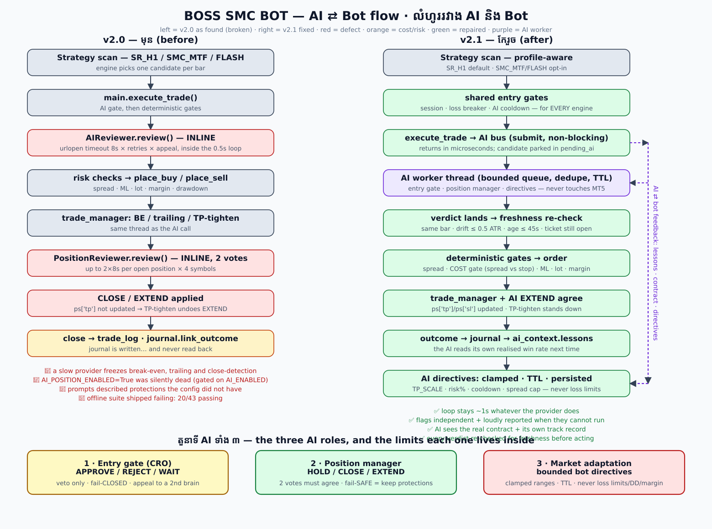
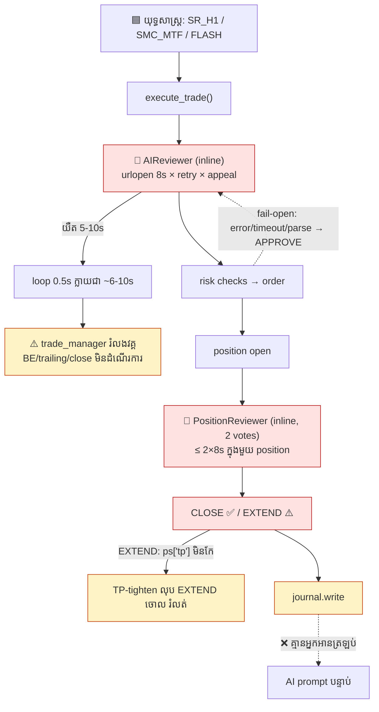
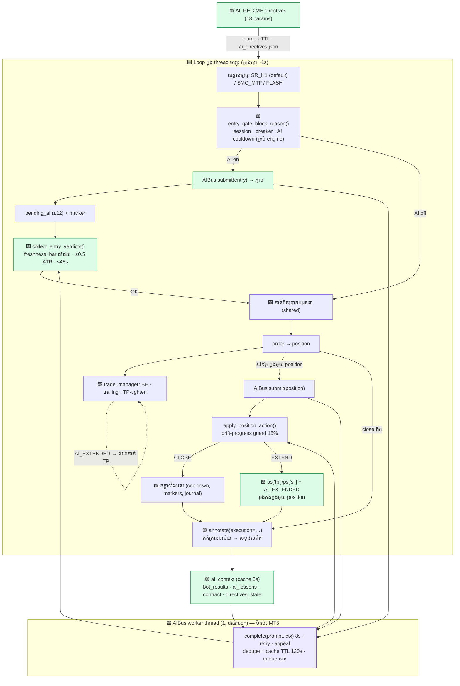
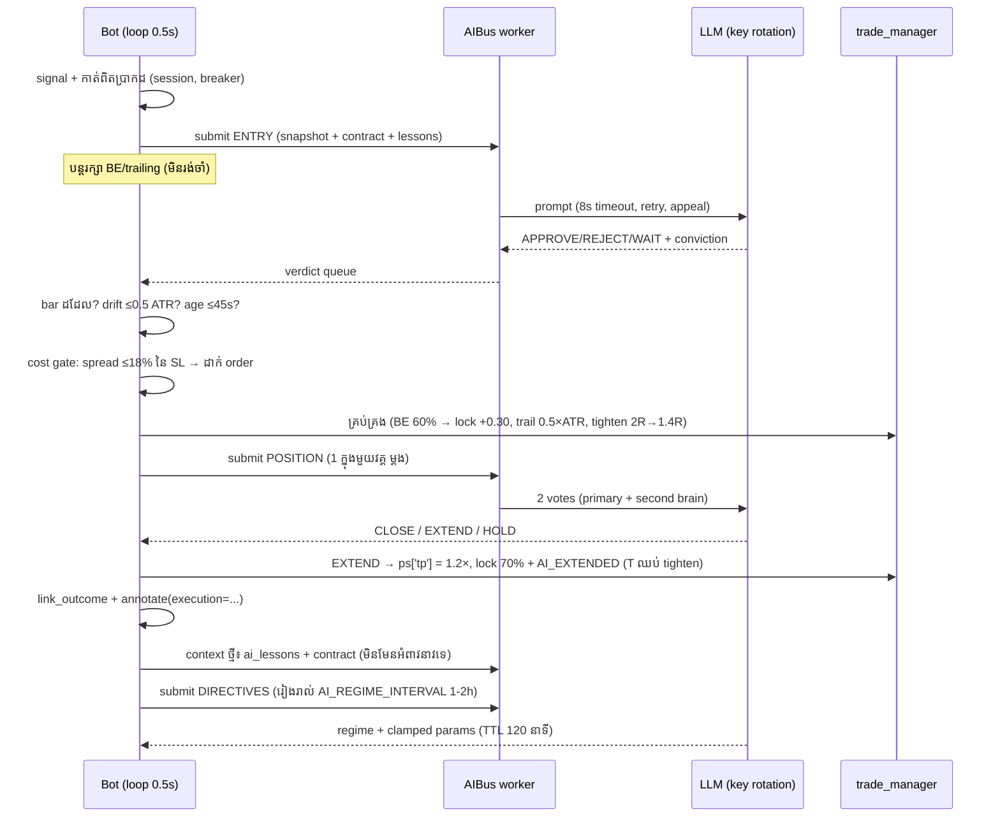

# លំហូរ AI ⇄ Bot (v2.1) — ការត្រួតពិនិត្យទាំងស្រុង + ការជួសជុល

> ឯកសារនេះពន្យល់ **លំហូរជាក់ស្តែង** រវាង AI និង bot, អ្វីដែលខូចនៅ v2.0,
> អ្វីដែលខ្ញុំកែនៅ v2.1, និង **តួនាទីពិតរបស់ AI ចំពោះប្រាក់ចំណេញ**
> (ផ្អែកលើ `REAL_WORLD_TEST.md` របស់ repo ដើម មិនមែនមតិទេ)។
>
> File: `docs/FLOW_AI_BOT.md` · រូបភាព: `docs/flow_ai_bot.svg`

---

## ១) សេចក្តីសង្ខេប (read this first)

| សំណួរ | ចម្លើយ |
|---|---|
| AI ដំណើរការនៅ v2.0 ទេ? | **ទេ — ស្ទើរតែគ្មាន** ក្នុង configuration ដើម: `AI_REVIEW_ENABLED=False`, `AI_POSITION_ENABLED` ត្រូវការ `AI_ENABLED` (False), `AI_REGIME_ENABLED` ក៏ដូចគ្នា → `ai_reviewer=None` ប៉ុន្តែ log នៅបោះពុម្ព «AI gate ON» ក្លែងក្លាយ |
| AI ជាមួយ bot «ធ្វើការល្អ» ទេ? | **ទេ** — ទិសតែមួយ (AI→bot) គ្មានត្រឡប់មកវិញ; AI ធ្វើការ **ក្នុង thread តែមួយ** នឹង loop 0.5s → បើ AI យឺត ការពារទាំងអស់ (BE/trailing/close) ឈប់ដំណើរការ |
| អ្វីដែលខ្ញុំកែ? | រចនាសម្ព័ន្ធឱ្យ AI ទទួលខុសត្រូវពិត: **bus ថ្មី + worker thread**, freshness re-check, តម្រឹម EXTEND រួមជាមួយ trade manager, **feedback ត្រឡប់ទៅ AI** (តួនាទី/កិច្ចសន្យា/កំហុស/ទិន្នន័យចុងក្រោយ), directives មានឥទ្ធិពលពិត, cost gate, តេស្ត **89** តែងតាំងជា ៤ បណ្តុំ |
| AI ធ្វើឱ្យ bot មានប្រាក់ចំណេញទេ? | **មិនមែនជាការបញ្ចូល edge ទេ** — edge របស់ bot កំណត់ដោយ engine + TF + cost។ តាម `REAL_WORLD_TEST.md`: M1 (spread Exness) PF **0.69**, MTF ពេញលេញ PF **0.93** (−0.165R/ជួល), តែ **SR_H1 (H1) PF 1.15 · +0.02R · maxDD 4.0R**។ តួនាទី AI = **កាត់ការខាតបង់** (កុំចូលពេល spread ធំ, បិទទាន់ពេល, រក្សា BE) មិនមែនបង្កើតសញ្ញាថ្មីទេ |

**លទ្ធផលសាកល្បង (v2.1):** `verify_ai_flow.py` 41 ✅ · `verify_ai_entry.py` 43 ✅ · `verify_fix.py` 2 ✅ · `verify_v17.py` 3 ✅ = **89 tests, all green** ។
End-to-end ជាមួយ broker ក្លែងក្លាយ: SIGNAL → AI APPROVE → order → BE/trailing → AI EXTEND → AI CLOSE → journal បញ្ជាក់ **តាមពិត**។

---

## ២) រូបភាពរួម



---

## ៣) លំហូរនៅ v2.0 (មុន) — កន្លែងដែលខូច



**៩ មេរៀនសំខាន់ពីរូបខាងលើ** (ម្តងមួយៗមានការធានានៅ មុខ ៥):

1. AI ស្ថិតក្នុង thread តែមួយជាមួយ loop គ្រប់គ្រង — ការយឺតរបស់ AI គឺការស្ងប់ស្ងាត់របស់ការពារ
2. `AI_*_ENABLED` ជាប់ខ្សែពី `AI_ENABLED` → បិទ AI ទាំង ៣ មុខងារដោយស្ងាត់
3. ពេល AI ខុស (`error/timeout/parse_error`) → bot ** APPROVE** ដោយស្វ័យប្រវត្តិ (fail-open) សម្រាប់ទាំង entry និង position
4. AI បានបិទ (`CLOSE`) ប៉ុណ្ណោះដែលជោគជ័យ; `EXTEND` ត្រូវ Rule 4 (TP-tighten) លុបចោលក្នុងរយៈពេល ១ វិនាទី
5. journal សរសេរ ប៉ុន្តែគ្មាន prompt ណាអានវាទេ → AI ចងចាំអ្វីមួយ
6. Prompt រៀបរាយ BE 60/30%, trailing 0.5×ATR, TP-tighten 2R — **គ្មាន** នៅក្នុង build នោះ
7. រាល់ការធ្វើបច្ចុប្បន្នភាព position គឺជា file-lock + read-modify-write CSV ទាំងមូល (O(rows) ក្នុងមួយ bar)
8. Ultra-Fast mode បិទ RSI/ATR-expansion/blacklist/ML-confidence/loss breaker — ដូច្នេះ AI gate គឺជាការពារតែមួយគត់
9. `verify_*.py` មិនអាចរត់បានក្នុងលក្ខខណ្ឌ offline (20/43 ប៉ុណ្ណោះដែលឆ្លងកាត់) ដូច្នេះការបែកបាក់ទាំងនេះមិនត្រូវបានចាប់

---

## ៤) លំហូរនៅ v2.1 (កែរួច)



### លំហូរពេញលេញក្នុងមួយជួល (sequence)



### ទម្រង់ ASCII (សម្រាប់អានក្នុង terminal)

```
+--------------------------------------------------------------------------+
| BOT LOOP — main thread — must stay ~1s whatever the AI does              |
|                                                                          |
| strategy scan (SR_H1 default) -> candidate for this bar                  |
|   -> shared entry gates: session, loss breaker, AI reject cooldown       |
|   -> AI on?  AIBus.submit(entry)  ... returns in microseconds            |
|      AI off? deterministic gates run anyway (same set, every engine)     |
|   <- collect_entry_verdicts(): same bar? drift<=0.5 ATR? age<=45s?       |
|   -> COST gate (spread<=18% of SL), ML, lot, margin -> ORDER placed      |
|   -> trade_manager: BE 60/30, trail 0.5xATR, tighten 2R->1.4R            |
|      AI EXTEND -> ps['tp'] updated + AI_EXTENDED -> Rule 4 stands down   |
|   -> 1 position review per cycle -> CLOSE (blockers re-checked) or HOLD  |
|   -> outcome -> journal.link_outcome + annotate(execution = truth)       |
|   -> AI directives: 13 params, clamped to ranges, TTL 4h, persisted    |
|--------------------------------------------------------------------------|
| ai_context (cache 5s) feeds EVERY prompt:                                |
|   management_contract()  = the real protections + real numbers           |
|   ai_lessons()           = AI proposal vs what actually happened         |
|   bot_results()          = realised WR/PF by engine, recent losses       |
|   news_blackout          = live blackout window                          |
| AIBus worker thread(s) — never touches MT5, only text in/out:            |
|   queue<=12 (drop -> 10s backoff)  |  dedupe  |  cache TTL 120s          |
|   3 roles: entry gate | position manager | market adaptation             |
+--------------------------------------------------------------------------+
```

---

## ៥) តារាងការជួសជុល (រាល់ចំណុចមានតេស្ត)

| # | អ្វីដែលខូច (v2.0) | ធ្ងន់ធ្ងរ | ការជួសជុល (v2.1) | តេស្ត |
|---|---|---|---|---|
| 1 | AI ទាំង ៣ មុខងារ `None` នៅ runtime; log ប្រកាស «AI gate ON» ក្លែងក្លាយ | 🔴 critical | `config.ai_entry_on()/ai_positions_on()/ai_directives_on()` ឯករាជ្យ + `ai_status_lines()` banner + `ai_flow_summary()` បង្ហាញ ON/OFF/NOT CONFIGURED + ជួរ | `TestHonestSwitches` (3) |
| 2 | `verify_ai_entry.py` ប៉ះទង្គិច (20/43) ព្រោះ fixture ប្រើ `XAUUSD` ខណៈ config = `EURUSD`; ការគណនា `client.last_key_number` ដោយគ្មានលក្ខខណ្ឌ | 🔴 | `state_for(symbol)` + guard លើ attribute | ទាំងស្រុង ✅ |
| 3 | Prompt រៀបរាយការពារដែល build មិនមាន → AI វាយតម្លៃលើក្តីស្រមើល | 🔴 | `management_contract()` បង្កើតពី config ពិត (រាល់លេខមកពី build, មិនមែនអត្ថបទថេរ) | `TestManagementContract` |
| 4 | HTTP ក្នុង thread loop (0.5s) → ការយឺតរបស់ AI សម្លាប់ការពារ | 🔴 | `core/ai_bus.py` worker + cache/dedupe/caps; bot មិនប្លុក | `TestLoopNeverBlocks` |
| 5 | លទ្ធផលយឺតអាចបើកទីតានតាមតម្លៃចាស់ | 🟠 | freshness re-check (bar, 0.5 ATR, 45s) + re-arm marker; orphan marker រំលាយ | `TestStaleResultSafety` (4) |
| 6 | AI `EXTEND` ត្រូវ TP-tighten លុបចោល | 🟠 | កែ `ps['tp']/ps['sl']` + `AI_EXTENDED` flag (ម្តង/ទីតាន) + ឈប់ tighten | `TestExtendVsRule4` |
| 7 | `mark_execution` លាក់ `TypeError` ដោយស្ងាត់ (`ticket` ត្រូវតែមាន) → journal រក្សា `proposed` | 🟠 | `ticket=None` បាន + តេស្ត annotation | `TestJournalAnnotation` |
| 8 | journal ប្រកាស `tp_extended` មុនពេលវាបានធ្វើ → AI រៀនពីរឿងកុហក | 🟠 | `_journal` សរសេរ `proposed`; រាល់ផ្លូវ ៧ ផ្លូវត្រូវបាន annotate ពិត | `test_extend_is_annotated_as_applied_not_asserted_upfront` |
| 9 | ទិសតែមួយ: AI មិនដែលឃើញលទ្ធផលរបស់វា | 🔴 | `bot_results()` + `ai_lessons()` + `lessons_for_prompt()` បញ្ចូលក្នុង prompts ទាំង ៣ | `TestFeedbackIntoPrompts` |
| 10 | `AI_REGIME` ផ្លាស់ប្តូរ ២ global ដែលគ្មាន code អាន → no-op | 🟠 | ១៣ params មានឥទ្ធិពលពិត + clamp + TTL 4h + `ai_directives.json` (restore baseline) | `TestDirectivesReal` (6) |
| 11 | Ultra-Fast mode បិទការពារទាំងអស់ (RSI, ATR-exp, blacklist, ML-conf, loss breaker) | 🔴 | `BOT_PROFILE=balanced` (default ថ្មី) + កាត់សរសេរបណ្តុញសញ្ញា **គ្រប់ engine** (`entry_gate_block_reason`) | `TestSharedGates` (4) |
| 12 | spread 0.30 vs SL M1 = 11% នៃហានិភ័យ (ការខាតបង់ធំបំផុត) | 🟠 | `MAX_SPREAD_COST_PCT=18.0` gate (មុន place) + បង្ហាញក្នុង snapshot (`cost.spread_pct_of_stop`) | `test_cost_gate_blocks_a_stop_that_is_all_spread` |
| 13 | `AI_CIRCUIT_FAILURES/COOLDOWN` មានក្នុង config ប៉ុន្តែគ្មានអ្នកប្រើ | 🟠 | ភ្ជាប់ circuit breaker សម្រាប់ **position reviewer** (fail-**SAFE**: HOLD, 0 HTTP) | `TestFailModes` |
| 14 | រាល់ bar បន្ទាប់ AI reject → ធ្វើឡើងវិញរហូត (rate limit) | 🟡 | `AI_REJECT_COOLDOWN_SECONDS=45` អនុវត្ត + backpressure backoff 10s | `TestSharedGates` |
| 15 | `AI_EXTEND_TP_MULT=1.4 / LOCK=0.6` ធ្ងន់ធ្ងរពេល → ងាយបិទមុនកំណត់ | 🟡 | 1.15 / 0.80 (កន្លះ 2R → យក 80%) | `TestExtendVsRule4` |
| 16 | heartbeat មិនប្រាប់ថា AI កំពុងដំណើរការ/ទាញយកយឺត | 🟡 | បន្ថែម `AI-entry/-positions/-directives`, queue, engine, profile | `TestHonestSwitches` |
| 17 | logger បំពេញសំរាម «Invalid TP» រាល់ 0.4s ក្នុង trade manager | 🟡 | change-only logging (`signal_log`) សម្រាប់ ៤ សារ + modify-failed | smoke run (60s: 88 → 0) |

---

## ៦) ល្បឿន — អ្វីដែលវាសនាសម្រាប់ការគ្រប់គ្រងទីតាន

| លក្ខខណ្ឌ | v2.0 | v2.1 |
|---|---|---|
| រយៈពេល loop មធ្យម (AI ឆ្លើយតែ 2s) | ~2.0s (រាល់ AI call) | **1.0s** — ១០ វគ្គ < 0.05s (test) |
| AI យឺត 8s × 2 votes × 4 symbols | 8-16s នៃការស្ងប់ស្ងាត់ (BE មិនដំណើរការ) | loop បន្ត; ការសម្រេចចិត្តចូលពេលវាដល់ |
| AI queue ពេញ | n/a | បោះចោល + cooldown 10s (provider ស្ងប់) |
| journal rewrite ក្នុងមួយ bar | O(rows) × រាល់ ២០ bar | ដដែល សម្រាប់ entry; position តែពេល proposal (តិច) |

---

## ៧) អំពីប្រាក់ចំណេញ — អ្វីដែលតេស្តរបស់ repo បង្ហាញ

*(មិនមែនជាមតិទេ — `REAL_WORLD_TEST.md`, backtest 24 ខែ 2024–2025, Exness spread 0.30, SL-first)*

| Engine | ចំនួនជួល | WR | PF (spread) | E[R] | cost/SL |
|---|---|---|---|---|---|
| M1 SMC sweep (v1.x) | ~25× ច្រើនជាង | 34% | 0.69 | −0.34 | 11% |
| `SMC_MTF` (bot ធ្វើស្រាប់) | 10,746/2 ឆ្នាំ | 36% | 0.93 | −0.165 | 8% |
| **`SR_H1` (default ថ្មី)** | 426 | **36.2%** | **1.15** | **+0.020** | **4%** |
| `FLASH` (v2.0 flagship) | — | — | 0.67–0.78 | <0 | ធំ |
| ML gate (walk-forward OOS) | — | 38.5% | — | −0.14 | AUC 0.512 (កាក់) |

**ចំណុចសំខាន់:** edge នៅលើ TF តូចត្រូវបានសម្លាប់ដោយចំណាយ — ប្រសិនបើ spread = 11% នៃចម្ងាយ SL, RR 2:1 ត្រូវការ WR >37% ដើម្បីស្មើតម្លៃ។ នេះជាមូលហេតុដែល **cost gate (#12)** និង **H1 default (#11)** មានឥទ្ធិពលលើប្រាក់ចំណេញជាង prompt ណាមួយ។

**តួនាទីពិតរបស់ AI** (បន្ទាប់ពីការកែ): កាត់យោបល់ខុស (REJECT ពេល cost/សារព័ត៌មាន/គុណភាព sweep មិនល្អ), ការពារប្រាក់ចំណេញ (CLOSE ពេល structure បែក), រីក TP ពេលមានហេតុផល (EXTEND: TP +15%, ល็อក 80% នៃចំណេញ)។ វា **មិនអាច** បង្កើត edge ដែលគ្មាន។ ប្រសិនបើត្រូវការលទ្ធផល: រក្សា `ENTRY_ENGINE=SR_H1`, `BOT_PROFILE=balanced`, Raw/ECN account, demo 2–3 ខែ, គោលដៅ 2–5%/ខែ · DD <20%។

---

## ៨) វិធីបើក/បិទ (config)

| Flag | Default v2.1 | អត្ថនាម |
|---|---|---|
| `AI_ENABLED` | `False` | role 1 (entry gate) តែមួយគត់ — v2.0 ប្រើវាជា master ដែលបិទទាំង ៣ |
| `AI_POSITION_ENABLED` / `AI_REGIME_ENABLED` | `True` | ឯករាជ្យពី `AI_ENABLED` (v2.1) — ដំណើរការលុះត្រាតែ `AI_PROVIDER` + `AI_API_KEYS` មាន |
| `ENTRY_ENGINE` | **`SR_H1`** | v2.0 = `SMC_MTF` (PF 0.93) — ប្តូរតាម `ENTRY_ENGINE=SMC_MTF` |
| `BOT_PROFILE` | **`balanced`** | `ultra_fast` = បិទ deterministic filters |
| `AI_ASYNC` | `True` | `False` = ហៅ AI ក្នុង loop ដូច v2.0 (សាកល្បាយតែប៉ុណ្ណោះ) |
| `AI_ENTRY_MAX_AGE_SECONDS` / `AI_ENTRY_MAX_DRIFT_ATR` | 45 / 0.5 | freshness window មុនពេល entry ត្រូវបានអនុវត្ត |
| `AI_POSITION_MAX_DRIFT_PROGRESS` | 0.15 | ប្រសិនបើតម្លៃផ្លាស់ប្តូរ >15% នៃរយៈចម្ងាយទៅ TP → បោះចោល verdict |
| `AI_QUEUE_MAX` | 12 | backpressure ⇒ drop + backoff `AI_QUEUE_BACKOFF_SECONDS=10` |
| `AI_WORKER_THREADS` | 1 | 0 = ស្វ័យប្រវត្តិ (worker ១ ក្នុងមួយ role) |
| `MAX_SPREAD_COST_PCT` | 18.0 | spread គិតជា % នៃចម្ងាយ SL (research: >20% = ខាតបង់ទៀងទាត់) |
| `AI_EXTEND_TP_MULT` / `AI_EXTEND_LOCK_PCT` | 1.15 / 0.80 | ពេល EXTEND: TP រីក 15%, ល็อក 80% លើចំណេញ |
| `AI_REJECT_COOLDOWN_SECONDS` | 45 | ចលនាតាមក្រោយ AI REJECT (v2.0: 300s កំពុងកំណត់) |
| `AI_REGIME_TTL_SECONDS` | 14400 = 4 ម៉ោង | directives ផុតកំណត់ → ត្រឡប់ baseline |
| `AI_JOURNAL_MAX_ROWS` | 20000 | ការពារ file-lock/read-modify-write មិនឱ្យរីក |

**រាល់ flag ត្រូវបានបញ្ជាក់ក្នុង startup banner** — ប្រសិនបើ AI មិនដំណើរការ ឬ provider មិនមាន អ្នកឃើញមុនពេល ដំណើរការ។

---

## ៩) វិធីផ្ទៀងផ្ទាត់ដោយខ្លួនឯង

```bash
# venv ត្រូវការ pandas/numpy (MT5 មិនចាំបាច់សម្រាប់ offline tests)
python -m venv .venv && .venv/bin/pip install pandas numpy scikit-learn pytz python-dotenv

.venv/bin/python verify_ai_flow.py     # 41 ✅  លំហូរ AI ⇄ bot (v2.1)
.venv/bin/python verify_ai_entry.py    # 43 ✅  AI entry layer
.venv/bin/python verify_fix.py           # 2 ✅  ការជួសជុលស្នូល
.venv/bin/python verify_v17.py           # 3 ✅  cost/spread + session

# MetaTrader5 មិនមាននៅលើ Linux/macOS — bot ដំណើរការតែ Windows/Wine។
# រាល់តេស្តខាងលើដំណើរការក្រៅបណ្តាញ (no API keys, no terminal)។
```

សម្រាប់ពិនិត្យមើល loop ពិតជាមួយ broker ក្លែងក្លាយ + AI ក្លែងក្លាយ (រោងចក្រសាកល្បងរបស់ខ្ញុំ, មិនមែន repo code):
`python smoke_loop.py 40` → សរសេរ `/tmp/smoke_bot/bot.log` + journal/trade CSVs។

---

## ១០) សម្មតិកម្មដែលខ្ញុំមិនជួសជុល (ហេតុផល)

- **ML 0.6 weight inside `combined_score`** — ដំណើរការតាម code ដដែល (តែមិនដែលរៀនឡើងវិញពេញមួយថ្ងៃ); វាជាសំណួរយុទ្ធសាស្ត្រ មិនមែនសំណួរទំនាក់ទំនងទេ
- **`FLASH` 24/7 + hedge/escalate** — repo ធ្វើតេស្តដោយខ្លួនឯង: គ្មាន variant ណា PF ≥ 1.0 → រក្សា OFF ដោយ default
- **4 symbols ជាមួយ `AI_QUEUE_MAX=12`** — ការកំណត់ល្បឿនត្រូវបានរចនាឡើងដើម្បីការពារ provider; ប្តូរ flags បើ key អនុញ្ញាត
- **`_on_minute_update` នៅតែ synchronous** (30s timeout) — ក្នុងមួយម៉ោង ១ ដង + resume មួយដង; សម្រាប់ AI វាគ្មានបញ្ហាទេ (ទោះបីវាធ្វើឱ្យ loop យឺតម្តងមួយៗ)
